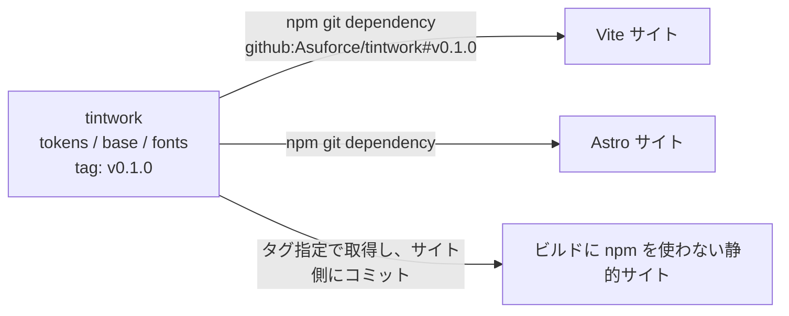

# tintwork: 設計

asuforce.com のデザインを、複数のサイトで使い回すための CSS 集。実装はまだない。

## 方針

CSS フレームワークではない。トークン、base、フォント、2 サイト以上で実際に使う部品だけを持つ。ビルドはなく、素の CSS を git タグで配る。見た目は asuforce.com に統一する。asuforce.com の `DESIGN.md` が正で、ここは値を移した写しになる。利用側が独自の値を持つのは、そのサイト固有の意味を持つ色（グラフ色など）だけにする。

## 構成

```text
tintwork/
├── tokens.css        # :root のトークン（色、フォント、幅、イージング）
├── base.css          # reset、body、focus-visible、skip-link、.container
├── fonts.css         # @font-face（フォントファイルは fonts/ を相対参照）
└── fonts/            # 公式配布の woff2 と、各ファミリのライセンス文
```

asuforce.com にだけ残すもの: ゴースト、月面、星、着地の動き、ナビやセクションなどのページ固有部品。
利用側にだけ残すもの: ナビのレイアウト、記事本文のスタイルなど、そのサイトの構造に依存するもの。2 サイト以上で使うことになった時点で `components/` へ移す。

## 配り方



- Vite と Astro のサイトは `import '@asuforce/tintwork/tokens.css'` のように CSS を読み込む（`fonts.css`、`tokens.css`、`base.css` の順）。Astro も Vite ベースなので同じ書き方になる。
- npm を使わないサイトは、タグを指定して CSS とフォントを取得し、サイトのリポジトリにコミットする。ビルド時に外部へ依存しない。
- 更新は tintwork 側でタグを切り、各サイトが任意のタイミングでタグを上げる。全サイトを同時に直す必要はない。

## トークン

asuforce.com の `:root` のうち、サイトを問わず使えるものだけを移す。ゴースト、月面、星、着地の位置など、サイト固有の変数は asuforce.com に残す。

| 役割 | トークン | ダーク | ライト |
|---|---|---|---|
| 背景 | `--bg` | #000000 | #f5f4f0 |
| 面 | `--surface` | #1c1c1c | 同じ |
| 罫線 | `--rule` | rgba(255,255,255,0.2) | rgba(0,0,0,0.2) |
| 本文 | `--text` | #ffffff | #111111 |
| 本文（弱） | `--text-soft` | #c8c8c8 | #444444 |
| 補助文字 | `--muted` | #8a8a8a | #6b6b6b |
| アクセント（塗り） | `--accent` | #c0fe04 | 同じ |
| アクセント上の文字 | `--on-accent` | #000000 | 同じ |
| アクセント（文字） | `--accent-text` | #c0fe04 | #4a6800 |
| フォーカスの輪 | `--focus` | #c0fe04 | #111111 |
| スクロールバー | `--thumb` | #c0fe04 | #111111 |
| フォント | `--font`、`--display`、`--mono` | 下の表 | |
| レイアウト | `--nav-h`、`--gutter` | 56px、clamp(16px, 4vw, 48px) | |
| 動き | `--ease` | cubic-bezier(0.16, 1, 0.3, 1) | |

ライトの切り替えは `:root[data-theme="light"]` で行う。属性を付ける script は各サイトが持つ。

## フォント

| 用途 | ファミリ | ライセンス | 配布元 |
|---|---|---|---|
| 見出し（700） | D-DIN | OFL 1.1（予約フォント名 "D-DIN"） | https://github.com/amcchord/datto-d-din |
| 本文（300、400） | Archivo | OFL 1.1 | https://github.com/Omnibus-Type/Archivo |
| 番号と日付（400） | JetBrains Mono | OFL 1.1 | https://github.com/JetBrains/JetBrainsMono |

- 3 ファミリとも公式の woff2 を無加工でリポジトリに入れ、ライセンス文を同じ場所に置く。D-DIN には `FONTLOG.txt` も添える。形式変換、サブセット化、名前変更はしない。
- Archivo は npm の再配布パッケージ（fontsource）ではなく、公式リポジトリの静的な woff2 を使う。可変フォントではなく Light と Regular の 2 本になる。
- D-DIN と Archivo には日本語の字形がない。スタックの末尾に `"Hiragino Kaku Gothic ProN"`、`"Noto Sans JP"` を足してある。
- フォントを単体で販売しない。配布元の名前を宣伝に使わない。

## 公開に向けた方針

- リポジトリは public にする。トークン、CSS、フォント、README、この文書だけを置き、特定サイトの内部構成、サーバーのアドレス、認証情報は入れない。
- 利用側のサイト名や非公開リポジトリの名前は、README とこの文書に書かない。
- CSS 部分は MIT、フォントは各ファミリの OFL に従う。README にこの 2 つの区分を書く。

## 決めること

1. `components/` に最初に入れる部品。ナビのリンク、ボタン、カードのうち、2 サイトで実際に使うものから選ぶ。
2. README に載せる見本ページを置くか。置くなら静的な 1 ページにして、GitHub Pages か Cloudflare で公開する。

## 進め方

1. リポジトリを作り、asuforce.com の `:root`、reset、base を移す。
2. フォントファイルと `OFL.txt` を入れ、`fonts.css` を書く。
3. asuforce.com を最初の利用者にして、見た目が変わらないことを実画面で確かめる。
4. v0.1.0 のタグを切る。
5. 他のサイトは、それぞれの立ち上げや改修のタイミングで取り込む。
